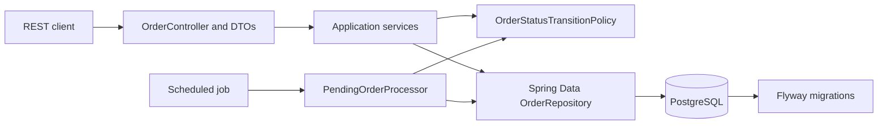
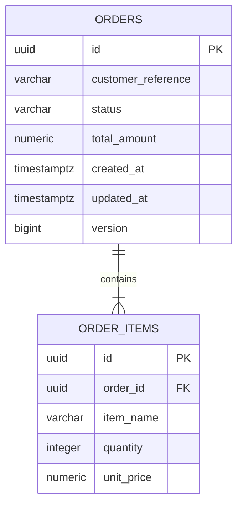
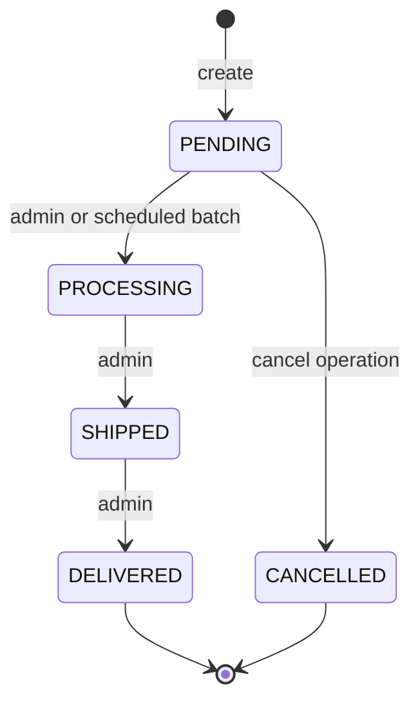

# Winter Order Processing

A Java 21 / Spring Boot modular monolith for creating and managing orders. The service stores order items and price snapshots transactionally, enforces a small explicit lifecycle, and moves a bounded number of pending orders to processing every five minutes.

The implementation intentionally excludes a product catalog, payments, authentication, distributed messaging, and AI runtime calls. Status and cancellation routes are administrative operations; an identity provider and authorization policy are outside this assignment scaffold.

## Architecture

The application is organized around the order feature, with separate HTTP, application, domain, persistence, and scheduling responsibilities.



### Package map

| Package | Responsibility |
| --- | --- |
| `api` | Versioned REST routes, request/response DTO mapping, validation errors, OpenAPI metadata |
| `application` | Transaction boundaries, order creation and retrieval, state changes, bounded processing batches |
| `domain` | Status values, allowed transitions, business exceptions |
| `persistence` | JPA aggregate and Spring Data repository with row-locking queries |
| `scheduling` | Cron-triggered adapter that invokes the separately testable processing service |
| `config` | Shared UTC clock |

### Database relationship



The order owns its item rows. Cascading persists and deletes the aggregate together; `orphanRemoval=true` is safe because line items are immutable in the API and have no independent lifecycle. The database foreign key also cascades delete. Prices and names are snapshots, so later catalog changes cannot alter prior orders.

## Order lifecycle



`CANCELLED` is the one additional terminal status needed to represent cancellation while retaining all four required statuses. The status endpoint accepts only the forward transitions. Cancellation has its own route and is accepted only from `PENDING`.

## API

All routes use `/api/v1`. Amounts are decimal values with two fractional digits. The assignment does not define a currency, so the API remains currency-neutral; a real multi-currency system should include an explicit ISO currency code.

| Method and route | Purpose | Success |
| --- | --- | --- |
| `POST /api/v1/orders` | Create an order; server calculates the total | `201 Created` with `Location` |
| `GET /api/v1/orders/{orderId}` | Retrieve order and item details | `200 OK`; `404` if absent |
| `GET /api/v1/orders?status=PENDING&page=0&size=20&sort=createdAt,desc` | Filter and page order summaries | `200 OK` |
| `PATCH /api/v1/orders/{orderId}/status` | Administrative forward status transition | `200 OK`; `409` for invalid transitions |
| `POST /api/v1/orders/{orderId}/cancel` | Administrative cancellation while pending | `200 OK`; `409` after processing starts |

Create request:

```json
{
  "customerReference": "customer-123",
  "items": [
    { "itemName": "Desk lamp", "quantity": 2, "unitPrice": 12.25 },
    { "itemName": "Cable", "quantity": 1, "unitPrice": 4.50 }
  ]
}
```

The response includes a UUID, item IDs and snapshots, total, status, and UTC timestamps. Client-supplied totals are not accepted. List responses contain `content`, `page`, `size`, `totalElements`, `totalPages`, `first`, and `last`; summaries avoid loading item collections for every row.

Example create response (IDs and timestamps vary):

```json
{
  "id": "9c28a293-e77d-4b80-a48b-26bd462f90f1",
  "customerReference": "customer-123",
  "items": [
    { "id": "2cdf99dd-7136-4ca4-98aa-6fd316ba903b", "itemName": "Desk lamp", "quantity": 2, "unitPrice": 12.25 },
    { "id": "52429692-8cbe-4bc7-8247-f3b1b497a94e", "itemName": "Cable", "quantity": 1, "unitPrice": 4.50 }
  ],
  "totalAmount": 29.00,
  "status": "PENDING",
  "createdAt": "2026-10-25T12:00:00Z",
  "updatedAt": "2026-10-25T12:00:00Z"
}
```

Example page response:

```json
{
  "content": [
    {
      "id": "9c28a293-e77d-4b80-a48b-26bd462f90f1",
      "customerReference": "customer-123",
      "totalAmount": 29.00,
      "status": "PENDING",
      "createdAt": "2026-10-25T12:00:00Z",
      "updatedAt": "2026-10-25T12:00:00Z"
    }
  ],
  "page": 0,
  "size": 20,
  "totalElements": 1,
  "totalPages": 1,
  "first": true,
  "last": true
}
```

Status request:

```json
{ "status": "PROCESSING" }
```

Validation and business errors use `ProblemDetail` with `type`, `title`, `status`, `detail`, `instance`, `code`, and `timestamp`. Request validation also returns an `errors` object keyed by field. Stack traces and database details are not returned.

## Scheduling, transactions, and concurrency

The job runs at `0 */5 * * * *` in UTC by default. Override `ORDER_PROCESSING_CRON`, `ORDER_PROCESSING_ZONE`, and `ORDER_PROCESSING_BATCH_SIZE` (default 100). Each invocation processes at most one bounded batch in a single transaction. `PendingOrderProcessor.processNextBatch` is directly callable in tests; tests never wait for the cron timer.

The processor selects pending rows in creation order under PostgreSQL pessimistic row locks. The status and cancellation services lock the same order row before checking and changing status. Therefore cancellation racing with processing serializes on the database row: whichever transaction changes `PENDING` first wins, and the other sees the new state and returns a conflict. `@Version` provides a second stale-write safeguard. A batch failure rolls back that batch and is logged by the scheduled adapter.

With multiple application instances, database row locks protect competing status changes and batch updates. This is not a distributed single-execution scheduler: instances can run the job concurrently and may wait on overlapping rows. No external scheduler lock or lease is implemented. A single tick handles only one batch; increase the configured batch size or invocation frequency if a backlog policy requires faster drain.

Order creation and item persistence share one transaction. Flyway owns the schema; Hibernate validates it at startup (`ddl-auto: validate`). Timestamps use `Instant` and PostgreSQL `TIMESTAMPTZ`, with the Hibernate JDBC timezone fixed to UTC.

## Design choices and patterns

- **Repository pattern:** Spring Data JPA isolates database operations, pagination, eager detail loading, and locking queries.
- **DTO and mapper separation:** API records do not expose JPA entities; `OrderApiMapper` converts at that boundary.
- **Dependency injection:** services depend on repositories, policies, mapper, and injected `Clock`; tests can substitute them.
- **Transition policy:** one small domain component owns forward-transition and cancellation rules. The State pattern is not used because the finite transition table is clearer and smaller.
- **Strategy pattern:** not used; there is only one processing policy.
- **Transaction and lock policy:** pessimistic row locks serialize cancel/status/batch writes; optimistic versioning protects against stale writes outside expected paths.
- **SOLID:** HTTP mapping, business policy, persistence, and scheduling each have a focused responsibility; application services depend on repository abstractions rather than controllers or framework globals.

## Run locally

Requirements: Java 21 and PostgreSQL 15+ (or Docker Compose). Set `JAVA_HOME` to a JDK 21 installation before running the Maven Wrapper.

For a local PostgreSQL server, set `DB_URL`, `DB_USERNAME`, and `DB_PASSWORD`, then run:

```powershell
.\mvnw.cmd spring-boot:run
```

For container execution, copy `.env.example` to `.env`, replace the development password, then run:

```powershell
docker compose up --build
```

The API listens on `http://localhost:8080`. Swagger UI is at `http://localhost:8080/swagger-ui.html`; OpenAPI JSON is at `http://localhost:8080/v3/api-docs`. Health is at `http://localhost:8080/actuator/health`.

The `.env.example` values are for local development only. Do not use them in a shared or production environment. Credentials are externalized and no secrets are committed.

## Tests

Run unit tests and available integration tests with:

```powershell
.\mvnw.cmd clean verify
```

The PostgreSQL integration suite uses Testcontainers and is configured to skip when Docker is unavailable. It covers HTTP validation and error responses, persistence/migrations, list paging and filtering, lifecycle rules, cancellation, direct scheduler processing, and a cancel-versus-process race. Unit tests cover calculations and lifecycle/processing behavior without waiting for the scheduler.

## Security and operational limits

Input validation, parameterized persistence queries, bounded pagination, database constraints, and centralized errors are implemented. Authentication and authorization are not configured; the status and cancellation routes are documented as administrative but are not protected by an identity provider. Do not expose these routes to untrusted clients until authorization is added. Actuator exposes health and info only, and health details are hidden.

There is no product catalog, stock reservation, payment handling, idempotency key, currency conversion, retry queue, distributed scheduler lease, or AI integration. A safe read-only assistant extension is outlined in [`docs/AI_EXTENSION_PROPOSAL.md`](docs/AI_EXTENSION_PROPOSAL.md); broader trade-offs are in [`docs/DESIGN_DECISIONS.md`](docs/DESIGN_DECISIONS.md).

## AI assistance disclosure

OpenAI coding assistance generated the initial architecture, application code, tests, and documentation from the assignment brief. The result was reviewed against the requirements and build output; compilation exposed an incorrect Spring exception import, which was corrected before the clean build and full test run. No human review is implied by this disclosure. The assignment author should review the code, rerun the documented commands, and be able to explain the trade-offs before presenting it.
