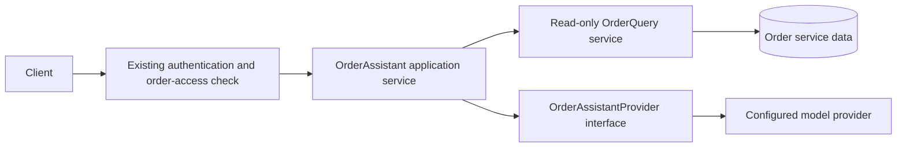

# Optional AI Order Assistant: Extension Proposal

## Status

This proposal is not implemented. The mandatory order service has no AI dependency, external model call, API key, or network requirement. Keep it that way unless the assignment owner approves the added feature and its privacy/authentication rules.

## Proposed scope

Add an optional assistant that can summarize an order and explain its current verified status in plain language. The feature must be read-only. It must not change status, cancel orders, authorize access, calculate an order total, or create claims that are not supported by the order service.

## Component boundary

The assistant service should receive a verified order summary from the existing application service after authorization. It should pass only fields needed for the response. The provider interface returns suggested wording; it does not receive repository access, persistence entities, credentials, or write tools. The application validates that the order still exists and remains accessible before returning the model output.

## Operational and security constraints

- Feature disabled by default and unavailable without a configured provider and API key.
- Authentication and order-level authorization must exist before enabling it.
- The model receives only the minimum verified order fields required for a summary.
- No tools, SQL, repository references, status mutation, cancellation, or persistence access are exposed to the model.
- Treat generated text as untrusted. A deterministic fallback can explain known status semantics when the provider times out or is unavailable.
- Never send secrets, full customer data, prompts, or internal exceptions to the model or client.
- Record only useful operational metadata, such as provider latency and fallback count; avoid logging prompts and personal data.
- Tests should cover disabled configuration, access denial, verified-data grounding, provider failures, and the absence of write behavior.

## Suggested implementation sequence

1. Define an `OrderAssistantProvider` interface and one provider adapter behind a feature flag.
2. Add an application service that authorizes access, reads an immutable summary, and applies a provider timeout and deterministic fallback.
3. Add a read-only API route only after an identity and order-ownership policy are available.
4. Add tests for authorization, grounded order facts, failure handling, and non-mutation.
5. Keep all existing create, status, cancel, and scheduled processing tests independent of provider configuration and network access.

This extension remains outside the two-day mandatory scope and should be omitted if it would reduce time for correctness, tests, or interview preparation.
